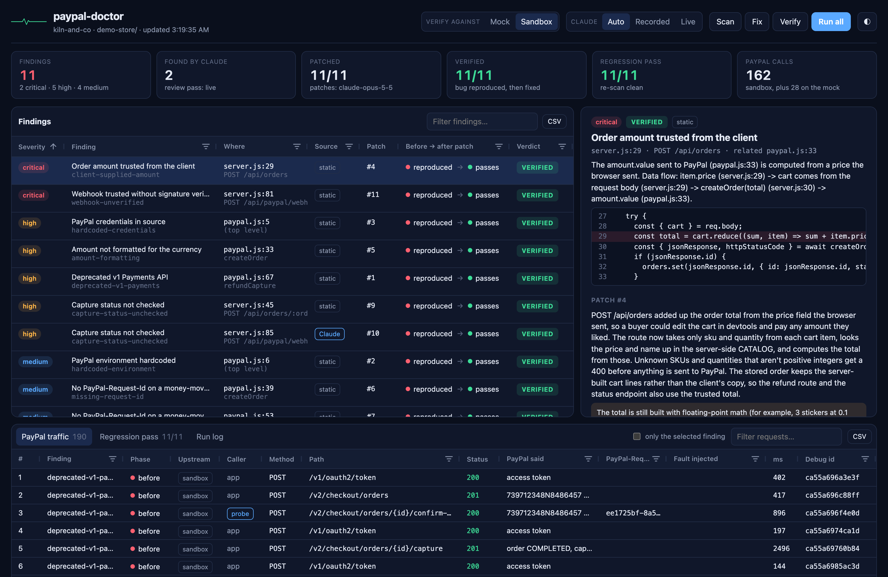

# paypal-doctor

[](https://github.com/furqan-khan07/paypal-doctor/actions/workflows/test.yml)

Finds PayPal integration bugs in a Node.js codebase, writes the fix, and then proves the fix works by running a real checkout against the PayPal sandbox, before and after the patch.



A read-only recording of a real run: https://paypal-doctor-demo.vercel.app

## Why

Most PayPal bugs don't crash anything. They lose money quietly. A webhook handler that believes any JSON posted to it. A cart total summed from prices the browser sent. A capture that came back `PENDING` but got treated as paid. A retry after a timeout that hits `ORDER_ALREADY_CAPTURED`, so the shop never records a payment it actually took.

A linter can flag the line, but "this might be wrong" is easy to ignore. I wanted a tool that shows the bug happening and then shows it gone. It's the same find-then-verify loop as pandas-doctor, my earlier project for slow pandas code.

## What it does

```
scan  ──►  fix  ──►  verify
```

**Scan.** Two passes. First, AST detectors (Babel parser, plus a small data-flow pass that follows a value across functions and files) for nine rules, each tied to a PayPal doc. Then a Claude review pass gets the PayPal-related files plus the static findings and looks for what they missed. Its findings are only kept if they name a known rule and quote evidence that's really on that line.

**Fix.** For each finding, Claude writes a minimal patch (find/replace edits) and a plain-English explanation. It sees the file with the bug, what that file imports and what imports it, plus the app's routes and a sample request. Patches form a chain: patch N is written against the code with patches 1..N-1 already applied, so each one can be tested on its own. A patch that doesn't apply cleanly, or doesn't parse afterwards, gets one retry with the error.

**Verify.** For each patch, the app is copied twice (before and after the patch), started with an interceptor preloaded, and driven through a scripted checkout:

- The **probe** plays the buyer with no browser: it approves the order through `confirm-payment-source` using PayPal's published sandbox test card, then lets the app capture.
- The **interceptor** records every PayPal call (credentials reduced to a fingerprint, card numbers masked). It can reroute hosts, and it can inject faults: drop a response after PayPal processed it, rewrite a capture to `PENDING`, add PayPal's negative-testing header. It refuses to let anything reach the live API.
- A patch is **verified** when the probe fails before it (the bug is reproduced) and passes after it. This happens as soon as the patch is written, before the next one. A patch that fails goes back to Claude once with the failing checks. If it still fails it's left out, so it can't take the rest of the chain down with it, and the dashboard shows it as left out.
- Then every probe runs once more on the fully patched app, and the static scan runs again, as a regression pass.

**Dashboard.** An AG Grid page with the findings, their patches and the before/after proof, plus a second grid with every PayPal request the probes made: status, `PayPal-Request-Id`, what PayPal said, which fault was injected, and the debug id. Both grids export to CSV.

## The rules

| Rule | What goes wrong |
|---|---|
| `client-supplied-amount` | Order total computed from prices in the request body; anyone can pay $0.01 |
| `webhook-unverified` | Webhook acted on without verify-webhook-signature; a forged event marks orders paid |
| `capture-status-unchecked` | Order marked paid without checking `captures[0].status` (PENDING / DECLINED) |
| `deprecated-v1-payments` | Calls to the deprecated `/v1/payments` API |
| `hardcoded-credentials` | Client secret in source, often as an env-var fallback |
| `amount-formatting` | Float math sent as the amount (`"0.30000000000000004"`), or decimals on JPY/HUF/TWD |
| `missing-request-id` | No (or a constant) `PayPal-Request-Id` on create/capture/refund |
| `hardcoded-environment` | Sandbox/live host hardcoded instead of configured |
| `deprecated-sdk` | `paypal-rest-sdk` / `@paypal/checkout-server-sdk` |

[docs/rules.md](docs/rules.md) has the exact detection logic, how each probe proves it, and the PayPal doc each rule rests on. [docs/validation.md](docs/validation.md) has how the static scan did on 60 public repos, including how badly the first run went. The detectors understand both raw REST calls (`fetch`, axios, got) and PayPal's current server SDK (`@paypal/paypal-server-sdk`): missing `paypalRequestId`, `Environment.Sandbox` hardcoded, an unchecked `captureOrder()` result. `test/fixtures/sdk-app` has an SDK-based example.

## Quick start (no keys needed)

Needs Node 20.10+.

```bash
git clone https://github.com/furqan-khan07/paypal-doctor.git
cd paypal-doctor
npm install
npm run demo
```

That scans the demo store in `demo-store/` (a small shop with ten bugs seeded on purpose), applies the patches, verifies each one against a local PayPal mock, and serves the dashboard at http://localhost:4417.

`npm run demo` replays what Claude answered in a real run, recorded in `src/llm/fixtures/`, and the dashboard says so at the top. Nothing in there is hand-written any more. The probes talk to the mock in `src/mock-paypal/`.

## With real keys: Claude + the PayPal sandbox

1. Create a sandbox app at [developer.paypal.com](https://developer.paypal.com) → Apps & Credentials (Sandbox). Make sure card payments are enabled for it: the probes approve orders with a sandbox test card.
2. Get an API key from [console.anthropic.com](https://console.anthropic.com).
3. `cp .env.example .env` and fill in `PAYPAL_CLIENT_ID`, `PAYPAL_CLIENT_SECRET` and `ANTHROPIC_API_KEY`. `.env` is gitignored, and the tool never prints or logs the values.
4. Check the sandbox app can do everything the probes need:

```bash
node bin/paypal-doctor.js preflight
```

5. Run everything for real:

```bash
npm run demo:real
```

This is `paypal-doctor run demo-store --mode sandbox --llm live --dashboard`: live Claude calls for the review and the patches, and real sandbox orders, captures and refunds for the probes. A few checks always run on the mock, and the dashboard says which:

- the "a correctly signed webhook is accepted" check, because only PayPal can sign an event, and it only does that when delivering to a public URL;
- the `PAYMENT.CAPTURE.PENDING` webhook probe, for the same reason;
- the credentials probe, so fake credentials never get sent to PayPal.

If `PAYPAL_WEBHOOK_ID` is empty, the doctor creates (or reuses) a webhook on your sandbox app pointing at `https://example.com/paypal-doctor-probe`. It needs a webhook id to call verify-webhook-signature.

To save the live answers as fixtures for offline demos, run with `--llm record` instead of `live`.

The first real run on the demo store verified 3 of 11 patches, and that was the doctor's fault. The second verified 11 of 11, for about $0.51 of Claude. [docs/real-runs.md](docs/real-runs.md) has both, including what went wrong and what these runs don't show.

## Using it on your own app

paypal-doctor needs to know how to start your app and which routes do what. Put a `paypal-doctor.json` in the app's root. Here's the demo store's:

```json
{
  "name": "kiln-and-co",
  "start": "node server.js",
  "readyPath": "/healthz",
  "env": { "port": "PORT", "apiBase": "PAYPAL_API_BASE", "clientId": "PAYPAL_CLIENT_ID",
           "clientSecret": "PAYPAL_CLIENT_SECRET", "webhookId": "PAYPAL_WEBHOOK_ID" },
  "routes": {
    "createOrder": "POST /api/orders",
    "captureOrder": "POST /api/orders/:orderID/capture",
    "refundOrder": "POST /api/orders/:orderID/refund",
    "webhook": "POST /api/paypal/webhook",
    "orderStatus": "GET /api/store-orders/:orderID"
  },
  "orderIdField": "id",
  "statusField": "status",
  "paidStatuses": ["paid"],
  "carts": {
    "standard":   { "body": { "cart": [{ "sku": "mug", "price": 18, "quantity": 1 }] },     "expect": { "currency_code": "USD", "value": "18.00" } },
    "tampered":   { "body": { "cart": [{ "sku": "mug", "price": 0.01, "quantity": 1 }] },   "expect": { "currency_code": "USD", "value": "18.00" } },
    "fractional": { "body": { "cart": [{ "sku": "sticker", "price": 0.1, "quantity": 3 }] }, "expect": { "currency_code": "USD", "value": "0.30" } }
  }
}
```

`orderStatus` should return your app's own record of the order, so a probe can tell whether the app thinks it got paid. Then:

```bash
node bin/paypal-doctor.js run path/to/app --mode sandbox
node bin/paypal-doctor.js dashboard
node bin/paypal-doctor.js apply path/to/app --yes --commits
```

`apply --commits` makes one git commit per verified patch, in order. Each commit message carries the explanation and the probe result: which checks failed before the patch, which pass after. It also writes a pull-request description (a table of every patch with its before/after result, plus anything to do before merging) to `.doctor/<name>/PULL_REQUEST.md`. Patches that failed verification are left out. Without `--commits`, `apply` just writes the patched files.

The static scan works on any repo, config or not. Probes need the config.

## GitHub Action

The static scan can run on your pull requests and comment what it finds. It needs no keys. It reads your code and never runs it.

```yaml
name: PayPal scan
on: pull_request
permissions:
  contents: read
  pull-requests: write
jobs:
  scan:
    runs-on: ubuntu-latest
    timeout-minutes: 10
    steps:
      - uses: actions/checkout@v7
        with:
          persist-credentials: false
      - uses: furqan-khan07/paypal-doctor@main
```

| Input | Default | What it does |
|---|---|---|
| `path` | `.` | Folder to scan, inside the checkout |
| `comment` | `true` | Comment on the pull request. Findings always go in the job summary. |
| `fail-on` | `none` | Fail the check on findings at this severity or above (`low`, `medium`, `high`, `critical`), in files the pull request changes |
| `github-token` | the default token | Used to read which files changed and to comment |

Outputs: `findings` and `findings-in-pr`.

This is only the scan. The patches and the sandbox proof need the full tool, with keys. The scan can be wrong too: on 20 repos it had never seen, 23 of 27 findings were correct ([docs/validation.md](docs/validation.md)).

What it does to stay safe on code it doesn't trust:

- **Nothing from your repo runs.** There's no install, no imports and no scripts from the code it scans. Babel parses the files, and symlinks aren't followed. A scan that hangs gets stopped after 5 minutes, without failing the check.
- **On a fork,** the default token is read-only, so it can't comment. The findings go in the job summary and as annotations, and the check doesn't fail because of that. Use `pull_request`, not `pull_request_target`.
- **File names are treated as hostile.** The comment only contains text from the rule table plus an escaped path and a line number. It never quotes your code. A file name can't break out of the comment or issue a workflow command.
- **It only updates its own comment.** It checks the author, not just the hidden marker, so anyone else's comment is left alone.

I've run it on a real pull request in this repo. The fork path has only been tested against a fake GitHub API so far.

## CLI

```
paypal-doctor run <dir> [--mode mock|sandbox] [--llm auto|live|replay|record|off] [--dashboard]
paypal-doctor scan <dir>       static detectors + Claude review
paypal-doctor fix <dir>        one patch per finding
paypal-doctor verify <dir>     before/after probes, then the regression pass
paypal-doctor apply <dir> --yes [--commits]
paypal-doctor dashboard [--port 4417]
paypal-doctor mock [--port 4455]     the PayPal mock on its own (point PAYPAL_API_BASE at it)
paypal-doctor preflight              sandbox readiness check
paypal-doctor status                 which keys are set (never prints them)
```

`--keep` on verify/run keeps the temp copies of the app and the raw traces around for poking at.

## How it's built

```
bin/paypal-doctor.js        CLI
src/scan/                   Babel AST detectors, data-flow helpers, Claude review pass
src/fix/                    patch chain, find/replace edits, diffing
src/llm/                    Claude client (live / record / replay), fixtures
src/verify/                 app runner, fetch interceptor, probes, sandbox client
src/mock-paypal/            local stand-in for the Orders v2 / Payments v2 / Webhooks APIs the probes use
dashboard/                  AG Grid dashboard + tiny HTTP server (SSE for live logs)
action.yml                  the GitHub Action, with scripts/action-scan.mjs
scripts/build-demo.mjs      a static, read-only copy of the dashboard from one recorded run
demo-store/                 Kiln & Co., the deliberately broken shop
```

- **Claude**: `claude-opus-5-5` through the official `@anthropic-ai/sdk`, with structured outputs (a JSON schema for findings and for patches), prompt caching on the rule-catalog system prompt, and server-side refusal fallbacks. Override the model with `PAYPAL_DOCTOR_MODEL`.
- **PayPal**: Orders v2 (create, confirm-payment-source, capture), Payments v2 (refund), Webhooks (verify-webhook-signature, webhook list/create), OAuth2 client credentials, `PayPal-Request-Id` idempotency, the `PayPal-Mock-Response` negative-testing header, and sandbox card rejection triggers.
- **AG Grid Community** (MIT) for both grids: custom cell renderers, the theming API wired to the page's CSS variables (light and dark), quick filters, column filters and sorting.
- No build step, no database. Node 20 built-ins plus four dependencies.

## Safety

- Requests to `api-m.paypal.com` (live) are blocked inside the app under test, whatever it's configured with.
- Secrets are read from `.env` or the environment and never printed. Log lines, the app's own output and traces all go through a redactor. Authorization headers are stored as a 12-character fingerprint.
- The dashboard only listens on 127.0.0.1 and refuses cross-origin POSTs, so another site can't make it run things.
- `apply` doesn't touch your code without `--yes`.
- The read-only demo build (`npm run demo:build`) copies a list of allowed fields from a recorded run, so raw PayPal traffic and credential fingerprints never get in. `npm run demo:audit` checks every byte before anything is published. `npm run demo:deploy` also removes the token Vercel writes when it links a folder, then audits again right before the upload.

## Limitations

- JavaScript/TypeScript on Node only. The interceptor covers global `fetch` and `node:http`/`node:https`, which axios, got and `@paypal/paypal-server-sdk` sit on top of. The fetch path is what the demo exercises; the http path has its own test, but hasn't been tried against a real SDK-based app yet.
- The data-flow pass is deliberately small: local bindings plus two hops across call sites. It will miss things a real taint engine would catch. The Claude pass is there partly to cover that.
- The mock is not a PayPal emulator. It implements the behaviour the probes rely on, and every check that matters can also run against the real sandbox.
- `PENDING` captures can't be triggered on demand in the sandbox, so that scenario rewrites a real sandbox capture response to `PENDING` with `PENDING_REVIEW`. The dashboard labels it as an injected fault.

## Tests

```bash
npm test
```

The tests cover the detectors (true positives and the exemptions that keep them quiet on correct code) and the mock's PayPal behaviour. There's an end-to-end scan → fix → verify of the demo store, the sandbox code path with the mock standing in for PayPal, and the Claude client's request shape against a fake API. The Action runs as a real process against a fake GitHub API, with hostile file names and a read-only token. The demo build is checked for what must never be published.

## License

MIT. See [LICENSE](LICENSE).
